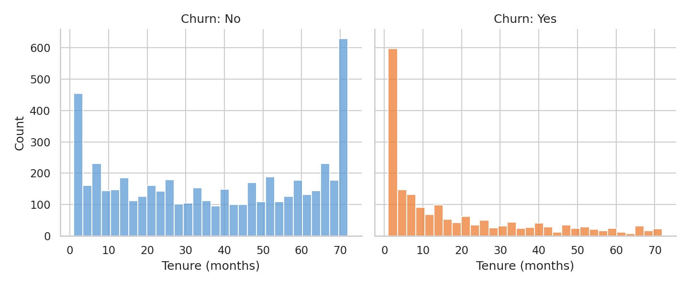
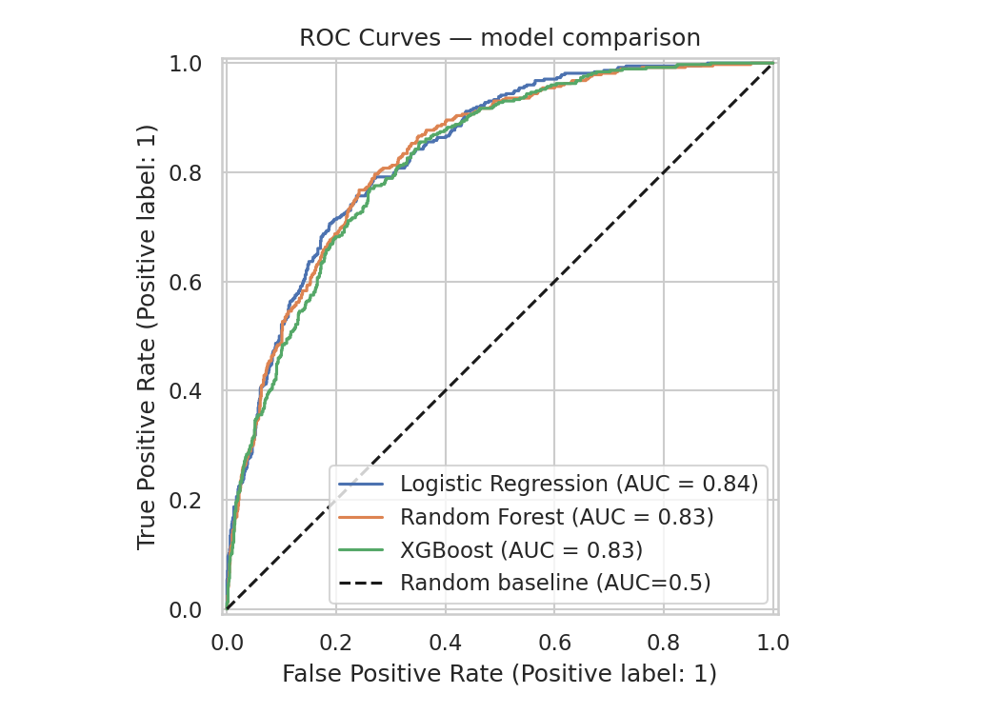
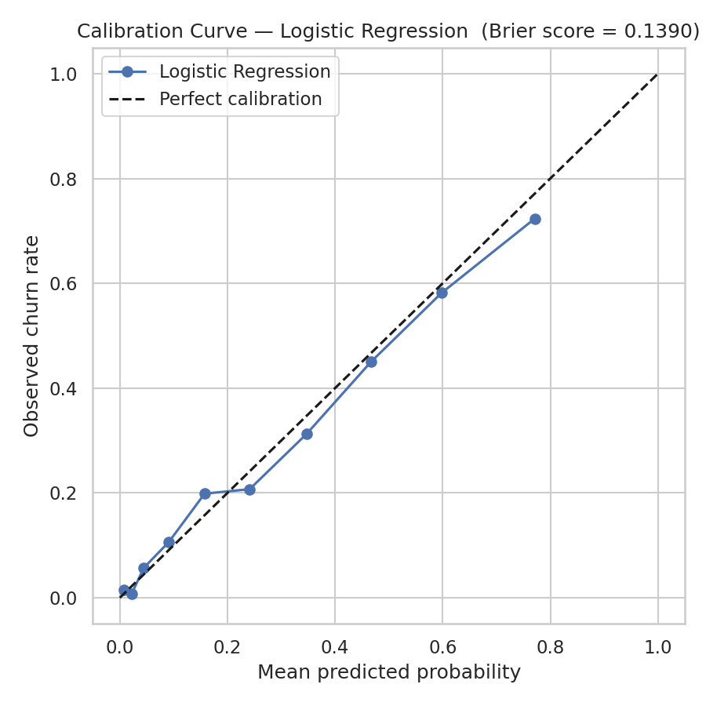
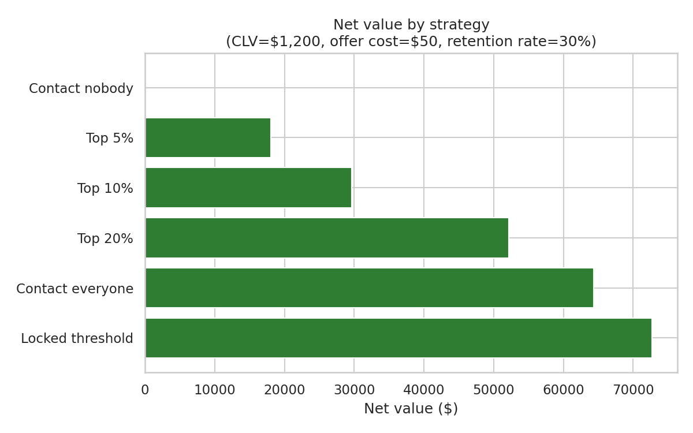
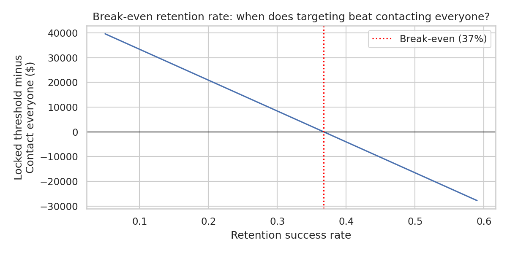

# Predicting Churn: From Signal to Retention Decision

Can churn be predicted well enough to support targeted retention, and under what economic conditions does acting on those predictions actually beat simpler alternatives? A model is only half the answer. This project treats the decision built on top of it as the real point.

## Two questions, not one

- **Data science question:** can customers at elevated churn risk be identified reliably?
- **Decision question:** can those predictions improve a retention strategy, and does that still hold once the assumptions behind it are stated openly?

Most churn projects stop at the first question. This one spends most of its effort on the second.

## Dataset

The IBM Telco Customer Churn sample dataset: 7,043 customers, of which 11 with missing billing data were dropped, leaving 7,032. Overall churn rate: 26.6%. Data is split 80/20 into training and test sets (1,407 test customers), stratified on churn, before any fitted transformation.

## Key findings

**1. Tenure is the clearest churn signal.** Churners are concentrated in their first months as customers, while long-standing customers rarely leave. Tenure and monthly charges are the two strongest individual predictors (Mann-Whitney U, p = 6.0×10⁻²¹¹ and p = 8.5×10⁻⁵⁴).



**2. The simplest model is the best one.** Logistic Regression, Random Forest and XGBoost land within about one point of each other on AUC-ROC, and Logistic Regression comes out on top on the test set (0.838) and in 5-fold cross-validation on the training data (0.848 ± 0.007). It was carried forward because it's both the best performer and the easiest to explain.



**3. The predicted probabilities can be trusted.** An earlier version used class weighting to handle the imbalance, which pushed predicted probabilities well above the real churn rates. Removing the weighting and handling the imbalance through the decision threshold instead (0.35, chosen by cross-validation on training data only) gives a well-calibrated model: a Brier score of 0.139, against 0.195 for always predicting the base rate.



**4. Targeting with the model beats contacting everyone, at the base-case assumptions.** At the locked threshold, the model contacts 490 of 1,407 test customers (35%) and reaches 270 of the 374 churners (72%), at about twice the hit rate of random outreach. Assuming a customer lifetime value of $1,200, a $50 offer cost and a 30% retention success rate, that's worth $72,700, compared with $64,290 for contacting everyone.



**5. That conclusion depends on how well retention offers work.** Targeting wins as long as offers succeed less than about 37% of the time. Above that, saving every possible churner is worth the cost of contacting everyone. The sensitivity analysis also shows the result flipping at a $1,600 lifetime value or a $30 offer cost. So the practical recommendation is conditional: before choosing a strategy, a business should measure its real retention success rate.



**6. The model's blind spot is long-contract customers.** It misses nearly all churners on one- and two-year contracts, because so few of them leave that the model learns to treat long contracts as safe. The two-year figure (a 100% miss rate) rests on only about 8 churners in the test set, so it's a small sample, but the pattern is consistent across contract and tenure segments.

## Approach

- **EDA:** Mann-Whitney U tests for continuous variables, and chi-square tests with Cramér's V for categorical ones, so every relationship is tested rather than judged by eye.
- **Feature engineering:** leakage-safe by design. Engineered features use fixed rules or per-row arithmetic; the two steps that need a dataset statistic (the spend-median threshold and one-hot encoding) are fitted on training data only.
- **Modelling:** three models compared on AUC-ROC, PR-AUC and F1, with 5-fold cross-validation as a stability check. Logistic Regression is trained inside a pipeline, so scaling is re-fitted within each cross-validation fold.
- **Threshold selection:** chosen to maximise F1 on out-of-fold predictions from the training set, then locked before the test set is used once for the final evaluation.
- **Calibration:** checked with a reliability diagram and Brier score against a base-rate reference.
- **Interpretation:** coefficients, SHAP values for individual customers, and an error analysis by contract, tenure, internet service and payment method.
- **Retention strategy:** six strategies compared (contact nobody, everyone, the top 5%, 10% or 20% by risk, or everyone above the locked threshold), with sensitivity and break-even analyses over lifetime value, offer cost and retention success rate.

## Limitations

- The data is a public sample snapshot, not a time series, so the model can't account for when customers churn or how behaviour changes over time.
- The lifetime value, offer cost and retention success rate are illustrative assumptions, not real figures. The analysis shows how to make the decision, not what the right numbers are for any particular business.
- The retention model assumes an offer only affects customers who would otherwise churn, and works equally well for everyone it reaches.
- Several features are strongly correlated (tenure, total charges and spend per month of tenure), so individual coefficients shouldn't be over-interpreted on their own.
- No hyperparameter tuning was done; the focus was on sound methodology rather than marginal performance gains.

## Reproducing the analysis

The dataset isn't included in this repo, since it's third-party data. Download the [Telco Customer Churn dataset](https://www.kaggle.com/datasets/blastchar/telco-customer-churn) and save `WA_Fn-UseC_-Telco-Customer-Churn.csv` in `data/`. Then:

```bash
python3 -m venv .venv
source .venv/bin/activate
pip install -r requirements.txt
```

Run the notebooks in order (01 → 04). Each one picks up the files saved by the notebook before it, and all figures are written to `data/plots/`. Versions are pinned in `requirements.txt` because results, particularly XGBoost's, can shift slightly between library versions.

## Structure

```
├── notebooks/
│   ├── 01_eda.ipynb
│   ├── 02_feature_engineering.ipynb
│   ├── 03_modeling_and_evaluation.ipynb
│   └── 04_retention_strategy.ipynb
├── images/              figures used in this README
├── data/                not included (see above); generated files are saved here
├── requirements.txt
└── README.md
```

## Stack

Python · pandas · scikit-learn · XGBoost · SHAP · matplotlib · seaborn
